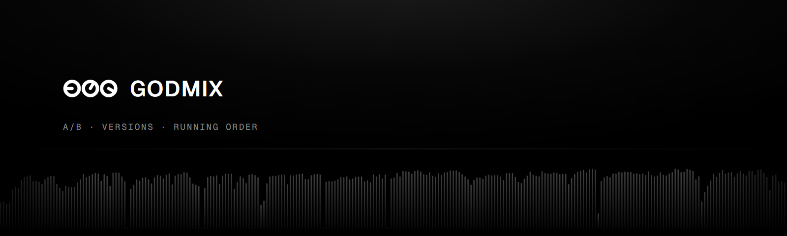
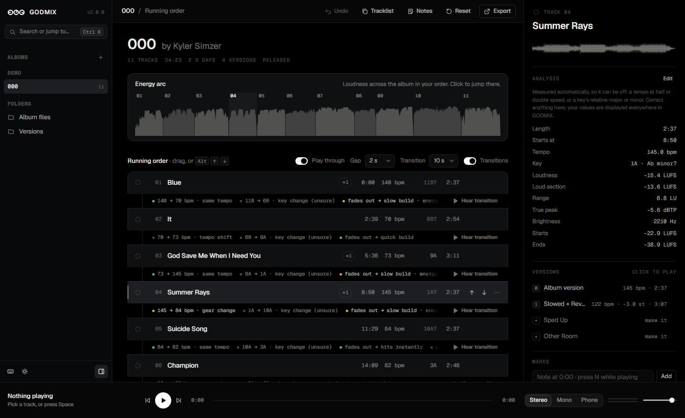

<p align="center"></p>

# GODMIX

**By Kyler Simzer** · [kyler@stems.fm](mailto:kyler@stems.fm) · [kylersimzer.com](https://kylersimzer.com)

Kyler Simzer's album tool. It makes masters that match on their loud sections and stay under the true-peak ceiling, and alternate versions (Slowed + Reverb, Sped Up, Other Room, Bass Boosted, Max Bass Boost) designed from each song's own measurements. It also includes the **GODMIX app**, a local listening room for A/B-ing every master and version in sync and building an album's running order.

<p align="center"></p>

**Status:** open source under the [MIT License](LICENSE) (the code; the music is © Kyler Simzer, see [License](#license-the-code-is-free-the-music-is-not)). It grew out of Kyler's own album work and runs best on Windows today; macOS and Linux work for the app. Your own albums and their settings live in `local/`, which git ignores. Working on it with an AI agent? Point it at [CLAUDE.md](CLAUDE.md).

## What it does

**The app** (`app/`, see [docs/APP.md](docs/APP.md))
- **A/B:** original against master, or album against a version. Both play in sync, can be loudness-matched, and switch in 12 ms.
- **Versions:** keys `0`–`9` switch versions mid-song and land on the same moment.
- **Listening checks:** stereo, mono and phone-speaker modes; loops (drag on the waveform) that follow the song across versions; a live peak meter; volume.
- **Running order:** drag or use the keyboard to reorder, with undo. Each seam is read for tempo, key and energy. Hear any transition with its real gap, play the album through, and see the album's energy arc.
- **Notes:**
  - Timestamped marks (`N`), notes and a status (needs work, approved) for each song.
  - **Mix notes** for the whole album: what still needs changing. Its **Copy all** button copies them with every song's notes and marks as Markdown, or Claude can read `app/state/<album>.json` directly.
  - **Notes** in the top bar (`P`) opens a notepad for the album: drag it anywhere, resize it, and add and name tabs.
- **Playback:**
  - Click a song to play it, and click again to pause.
  - The next song is preloaded, so play-through starts it instantly, and gaplessly at a 0 s gap.
  - Waveforms are drawn like stems.fm's: peaks and RMS from each file's own envelope.
  - Every control explains itself on hover.
- **Albums:** add one from a folder of finished songs, or change an album's title, subtitle or artist (`+` next to Albums, or right-click an album). Albums show as "000 by Kyler Simzer".
- **Analysis you can correct:** tempo, key and levels are measured automatically and can be off. Click **Edit** in a song's details to fix them; the corrections are used everywhere.
- **Make versions from the app:** songs without a Slowed + Reverb, Sped Up, Other Room, Bass Boosted or Max Bass Boost version still list it. Click **make it** and the song's version is designed from its measurements and rendered.
- **Trace Tags** (`R`): send a song or the album to several people, each with their own tagged copy. The tag is your typed words or your own recordings, optionally saying the person's name. If a copy leaks, drop it into **Check a leak** and GODMIX says whose it was.
- **Export:**
  - Tagged files in your running order: title, artist, album, track number, year, copyright, ISRC and cover art.
  - Formats: WAV as made (bit-exact), WAV 24-bit 48 kHz, 24-bit 44.1 kHz or 16-bit 44.1 kHz, AIFF, FLAC, ALAC, MP3 320 and AAC 256.
  - Or the whole album rendered as one file, with your gaps, a cue sheet and a tracklist.
  - Rename songs (right-click, or `F2`) and the new titles are used everywhere.
  - **Tracklist** copies each song with its start and end in the whole running order (`1. Two of Us 00:00 - 03:54`).
- **Keyboard first:** a command menu (`Ctrl K`), a shortcut for everything (`?` lists them), deep links (`/app#/demo/4`), media keys, and light and dark themes.

**The homepage** (`/`)
- Everything on it is drawn from the real albums, and the demo album plays through the app's own engine: a working player in the hero, a before-and-after crossfade with loudness matching and a live meter, a transition you can hear (Find You → Mantra), a running order you can drag, an analysis panel, a real tagged download, and a changelog with sound.
- Sound on the page starts at 60% (the volume control in the nav remembers your choice), never plays until clicked, and one thing plays at a time.
- Album cards are drawn from each album's loudness, one arc per song.

**The online demo** (`npm run demo`)
- The same app, started with `--demo`, for a website: the demo album only, streamed as MP3 320, read-only on the server. Visitors' notes stay in their browser, the buttons say **Try GODMIX**,, and making versions, exports or albums points to the setup steps and the GitHub repo. `python app/build_public.py` makes its files. See [docs/APP.md](docs/APP.md#the-online-demo).

**The scripts** (repo root)
- `render.py`: masters for the album being mastered (the one with `"masters"` set), as 24-bit/48k and dithered 16-bit/44.1k, with peaks checked after MP3, AAC, Opus and Vorbis encoding.
- `version_design.py` → `versions.py`: designs each song's versions from its measurements, then renders them for any album.
- Checks: `slowed_verify.py`, `slowed_loudness.py`, `harsh_check.py`, `reverb_check.py`, `perceived_loudness.py`, `analyze.py`, `sequence_analysis.py`, `check_edges.py`.

## Setup

You need **Node.js 20+** (for the app), **Python 3.12** (for measuring and rendering) and **ffmpeg** (for MP3, AAC and ALAC exports, the online demo's files and `render.py`'s encoding checks; without it, WAV, FLAC and AIFF still work).

```bash
python -m venv .venv                                  # macOS / Linux: python3 -m venv .venv
.venv\Scripts\python -m pip install -r requirements.txt   # macOS / Linux: .venv/bin/python -m pip install -r requirements.txt
```

Run the Python commands below with the venv's Python (`.venv\Scripts\python` on Windows, `.venv/bin/python` on macOS and Linux), or activate the venv first. `npm start` finds it on its own.

**Using an AI assistant?** Point it at [CLAUDE.md](CLAUDE.md) (or [AGENTS.md](AGENTS.md)). GODMIX ships with neutral mastering defaults, and the guide tells the assistant to ask about your music (genre, references, where it's heard, how loud) and save your answers as your own settings before it masters anything.

1. **Albums are listed in `local/albums.json`** (add one from the app, or by hand in the same format as `albums.json`, which holds the demo): each album's folder, and its tracks, or `"from-files"` to read them from the folder. Released albums are read-only.
   - A fresh clone has one album ready to go: the **demo**, 000 by Kyler Simzer, in `demo/000`. See [demo/README.md](demo/README.md); the audio is © Kyler Simzer, all rights reserved.
   - An album whose folder isn't on this computer is skipped.
2. **Build the app's data.** This measures every track and version, is cached, and is quick to re-run:
   ```bash
   python app/build_data.py            # every album found on this machine; or name them: python app/build_data.py demo
   ```
3. **Open the app:**
   ```bash
   npm start                           # serves http://localhost:8333/app and opens it
   ```
   On Windows you can double-click `GodMix.cmd` instead. Use another port with `node app/server.js 8400`.

Re-run step 2 whenever masters or versions change; the server picks up new data without a restart. The app has no npm dependencies, so there is no `npm install`.

## Common jobs

```bash
python version_design.py --album demo         # design versions from measurements → local/versions_cfg.json
python versions.py --album demo [track …]     # render them    (--only "Slowed + Reverb")
python slowed_verify.py --album demo [--fix]  # check tone, tuning and loudness
python render.py                              # master the album with "masters" set
python app/build_data.py demo                 # refresh the app
python app/build_public.py                    # the online demo's MP3s and download (app/cache/public)
npm run demo                                  # the online demo, locally: http://localhost:8334
npm test                                      # server tests
npm run design                                # rebuild logos, icons and banners (design/)
```

## Repo map

```
app/            the GODMIX app: server.js, build_data.py, jobs.py (make versions, exports, Trace Tags), web/ (homepage, app)
demo/000/       the demo album, 000, as FLAC (© Kyler Simzer, all rights reserved; see demo/README.md)
design/         brand: mark #136 "Three dials", lockups, icons, banners, screenshots, and their generator
docs/APP.md     how the app works: playback, API, jobs, data and state formats, shortcuts
tests/          server tests (node --test)
LICENSE         the MIT License (the code only: not the demo audio, not the GODMIX or stems.fm marks)
NOTICE.md       copyright, licences and third-party software
*.py            mastering and version scripts; albums.json, versions_cfg.json and render_cfg.json are their settings (the demo's and the defaults)
plans/          the demo's version design, written by version_design.py
local/          your own albums, their settings and plans (ignored by git; see albums.py)
```

The only audio in this repo is the demo album's FLACs. `.gitignore` blocks every other audio file, and everything the scripts and the app generate: `app/data`, `app/cache`, `app/state`, and the demo's `Versions` and `Exports`.

## License: the code is free, the music is not

| | What you can do |
|---|---|
| **The code** | Open source under the [MIT License](LICENSE): use it, change it and share it, keeping the copyright notice. |
| **Kyler Simzer's music** | **© Kyler Simzer, all rights reserved.** This means the demo album 000 in `demo/`, every version or export made from it, and all of his other music, released or not: recordings, compositions, lyrics, artwork and track lists. You may play the demo inside GODMIX to try the software. You may not copy, share, upload, stream, sample, remix, re-release, sync or train AI on it without his written permission. |
| **The GODMIX and stems.fm names and marks** | Not licensed. |
| **Your own music** | Stays yours. Running it through GODMIX gives nobody any rights in it. |

Full terms are in [NOTICE.md](NOTICE.md) and [demo/README.md](demo/README.md).

## Credits

GODMIX is designed and built by **Kyler Simzer**, and the music in `demo/` is his: written, produced and released as **000**.

- Contact: [kyler@stems.fm](mailto:kyler@stems.fm)
- Music: [kylersimzer.com](https://kylersimzer.com) · [Spotify](https://open.spotify.com/artist/7aVm8fnxM8eVrusQveFs98) · [Apple Music](https://music.apple.com/us/artist/kyler-simzer/1826036316) · [SoundCloud](https://soundcloud.com/kylersimzer) · [YouTube](https://www.youtube.com/@kyler_)
- Elsewhere: [stems.fm](https://stems.fm) · [X](https://x.com/kyler1s) · [Instagram](https://www.instagram.com/kyler/)

Music © Kyler Simzer, all rights reserved. Code © 2026 Kyler Simzer, MIT License.
